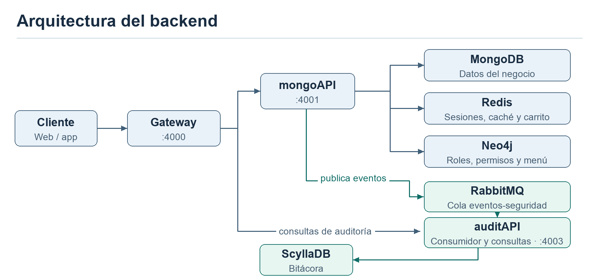
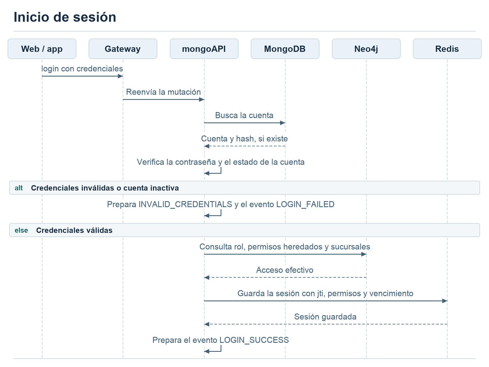
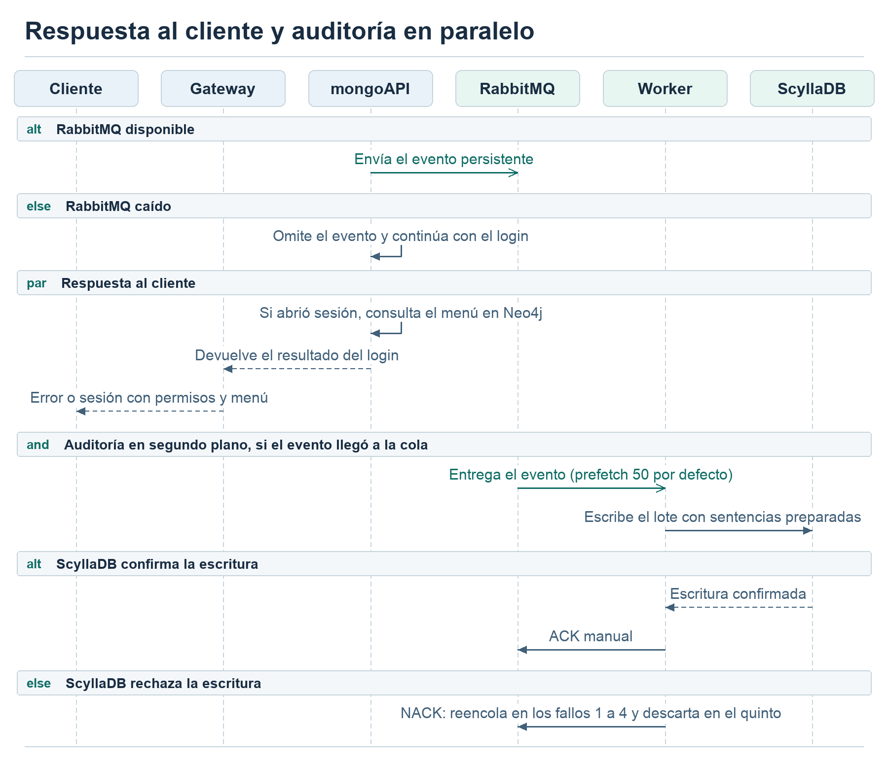
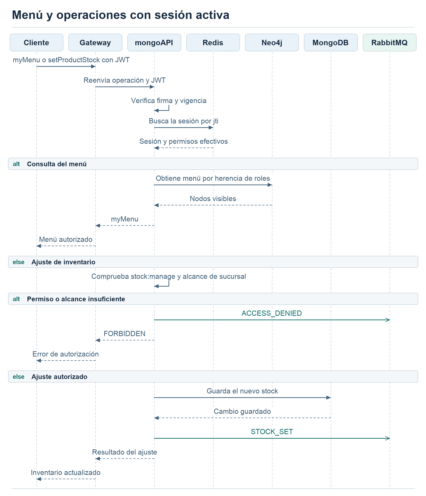
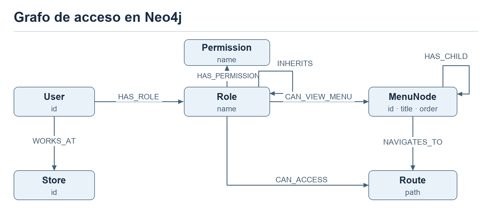

# Plan: roles en Neo4j y bitácora de auditoría en ScyllaDB

Basado en el ejemplo `Proyecto-20261112` (servicio de seguridad con RBAC en Neo4j que
emite eventos a RabbitMQ) y en `auditoria-service` del boilerplate (consumidor que
persiste en ScyllaDB).

## Arquitectura



<details>
<summary>Ver arquitectura en texto</summary>

```text
Cliente ─► Gateway :4000 ─┬─► mongoAPI :4001 ──► MongoDB   (datos del negocio)
                          │        │  ├────────► Redis     (sesiones con permisos, caché, carrito)
                          │        │  ├────────► Neo4j     (roles, permisos, sucursales, menús)
                          │        │  └─ eventos ─► RabbitMQ  cola "eventos-seguridad"
                          │        │                    │
                          └─► auditAPI :4003 ◄──────────┘ consume
                                   └────────► ScyllaDB  (bitácora inmutable)
```

</details>

- mongoAPI **nunca** escribe en ScyllaDB: publica eventos y sigue (fire-and-forget).
- auditAPI es el único que escribe en ScyllaDB y expone las consultas de auditoría.

## Diagrama de secuencia integral (UML)

El flujo crítico del usuario termina en mongoAPI; la publicación de auditoría no espera a que el worker confirme la escritura. El worker procesa los mensajes por separado, con un máximo de 50 sin confirmar. Si RabbitMQ no está disponible, mongoAPI registra el aviso y continúa con la operación del usuario; ese evento no se conserva localmente.







<details>
<summary>Ver la fuente Mermaid del diagrama integral</summary>

```text
sequenceDiagram
    autonumber
    actor Usuario
    participant Cliente as Web / app / Apollo Sandbox
    participant Gateway as Apollo Gateway
    participant API as mongoAPI
    participant Mongo as MongoDB
    participant Neo as Neo4j
    participant Redis
    participant Rabbit as RabbitMQ
    participant Worker as auditAPI worker
    participant Scylla as ScyllaDB

    Usuario->>Cliente: Envía credenciales
    Cliente->>Gateway: mutation login
    Gateway->>API: Reenvía login y contexto HTTP
    API->>Mongo: Busca usuario y verifica contraseña
    Mongo-->>API: Resultado de autenticación

    alt Credenciales inválidas o cuenta inactiva
        API->>API: Prepara INVALID_CREDENTIALS y LOGIN_FAILED
    else Credenciales válidas
        API->>Neo: Lee rol, permisos heredados y sucursales
        Neo-->>API: Acceso efectivo
        API->>Redis: Guarda sesión activa con jti y permisos
        Redis-->>API: Sesión guardada
        API->>API: Prepara token, access y LOGIN_SUCCESS
    end

    alt RabbitMQ conectado
        API-)Rabbit: Encola LOGIN_FAILED o LOGIN_SUCCESS (persistente)
    else RabbitMQ no disponible
        API->>API: Registra aviso y continúa sin guardar el evento
    end
    Note over API,Rabbit: Fire-and-forget: la respuesta no espera al ACK del worker

    opt Credenciales válidas
        API->>Neo: Consulta menú visible para el rol
        Neo-->>API: Nodos de menú autorizados
    end

    par Camino síncrono del usuario
        API-->>Gateway: Devuelve error o sesión, access y menú
        Gateway-->>Cliente: Respuesta GraphQL
        Cliente-->>Usuario: Resultado del login
    and Auditoría en segundo plano
        opt Hay evento en la cola y ScyllaDB está listo
            Rabbit-->>Worker: Entrega evento (prefetch máximo 50)
            Worker->>Scylla: Escribe con sentencias preparadas
            alt Escritura confirmada
                Scylla-->>Worker: Persistencia confirmada
                Worker->>Rabbit: ACK manual
            else Falla la escritura
                Scylla-->>Worker: Error de persistencia
                Worker->>Rabbit: NACK y reencola para reintento
            end
        end
    end

    opt Llamadas posteriores con sesión válida
        opt Consulta del menú dinámico
            Cliente->>Gateway: query myMenu
            Gateway->>API: Reenvía consulta y JWT
            API->>API: Verifica firma y vigencia del JWT
            API->>Redis: Comprueba sesión activa por jti
            Redis-->>API: Sesión y usuario
            API->>Neo: Obtiene menú por herencia de roles
            Neo-->>API: Menú autorizado
            API-->>Gateway: myMenu
            Gateway-->>Cliente: Menú visible
        end

        opt Mutación protegida (ejemplo: setProductStock)
            Cliente->>Gateway: mutation con JWT
            Gateway->>API: Reenvía mutación
            API->>API: Verifica firma y vigencia del JWT
            API->>Redis: Comprueba sesión activa por jti
            Redis-->>API: Sesión con permisos efectivos
            API->>API: Resolver comprueba permiso y alcance
            alt Sin permiso
                API-)Rabbit: ACCESS_DENIED
                API-->>Gateway: GraphQL FORBIDDEN
                Gateway-->>Cliente: Error sin escritura en MongoDB
            else Con permiso
                API->>Mongo: Persiste el cambio
                Mongo-->>API: Cambio confirmado
                API-)Rabbit: STOCK_SET u otro evento de dominio
                API-->>Gateway: Resultado de la mutación
                Gateway-->>Cliente: Resultado
            end
        end
    end
```

</details>

El mismo camino de auditoría recibe `LOGIN_FAILED`, `LOGIN_SUCCESS`, `USER_REGISTERED` y `ROLE_CHANGED`; además, el plugin GraphQL registra los accesos denegados como `ACCESS_DENIED`. En todos los casos se filtran contraseñas, hashes y tokens completos antes de publicar.

## 1. Neo4j: roles y permisos (RBAC)

### Roles (jerarquía con `INHERITS`)

| Rol | Hereda de | Para quién | Permisos propios |
|---|---|---|---|
| `CUSTOMER` | — | Cliente que compra | (ninguno: lo suyo se controla por dueño) |
| `STAFF` | CUSTOMER | Empleado de mostrador | `orders:prepare`, `stock:manage` |
| `DELIVERY` | CUSTOMER | Repartidor | `orders:deliver` |
| `MANAGER` | STAFF | Gerente de sucursal | `catalog:manage`, `reports:view` |
| `ADMIN` | MANAGER | Dueño / sistemas | `orders:deliver`, `stores:manage`, `users:manage`, `audit:view`, `scope:all_stores` |

Permisos efectivos = los del rol + los de todos los roles heredados (`[:INHERITS*0..]`).

### Grafo



<details>
<summary>Ver relaciones del grafo en texto</summary>

```text
(:User {id})-[:HAS_ROLE]->(:Role {name})-[:INHERITS]->(:Role)
(:Role)-[:HAS_PERMISSION]->(:Permission {name})
(:User)-[:WORKS_AT]->(:Store {id})                 alcance por sucursal
(:Role)-[:CAN_ACCESS]->(:Route {path})             solo el rol más bajo autorizado
(:Role)-[:CAN_VIEW_MENU]->(:MenuNode)-[:NAVIGATES_TO]->(:Route {path})
(:MenuNode)-[:HAS_CHILD]->(:MenuNode)
```

</details>

- **Alcance por sucursal:** STAFF / DELIVERY / MANAGER solo actúan sobre órdenes de las
  sucursales con `WORKS_AT`. `scope:all_stores` (ADMIN) ve todas.
- **Fuente de verdad:** Neo4j. `users.role` en Mongo queda como espejo (se sincroniza al
  asignar rol y se auto-repara en el login, como en el ejemplo).
- **Rendimiento:** permisos y sucursales se calculan en el **login** y viajan en la sesión
  de Redis (`session:<jti>` pasa a ser JSON). Cada petición no consulta Neo4j.
- **Cambio de rol o de sucursal:** se revocan todas las sesiones del usuario
  (índice `user:<id>:sessions` en Redis) para que el cambio aplique de inmediato.
- **Neo4j caído:** el login funciona con permisos vacíos (nivel cliente) y se registra
  `RBAC_UNAVAILABLE`. Falla cerrado: nadie gana privilegios sin Neo4j.

### Reglas de órdenes

| Transición | Permiso | Condición |
|---|---|---|
| → CONFIRMED / PREPARING / READY | `orders:prepare` | sucursal en alcance |
| READY → DELIVERED (PICKUP) | `orders:prepare` | sucursal en alcance |
| READY → IN_DELIVERY → DELIVERED (DELIVERY) | `orders:deliver` | sucursal en alcance |
| → CANCELLED | dueño, o `orders:prepare` | sucursal en alcance |

### Operaciones nuevas

- `login` devuelve además `access { role permissions stores }` y `menu`.
- `myAccess`, `myMenu` (cualquier sesión).
- `roles` (catálogo con permisos y herencia) — `users:manage`.
- `userAccess(userId)`, `assignRole(userId, role)`, `assignUserToStore`,
  `removeUserFromStore` — `users:manage`.
- `orders` filtra por rol: cliente → las suyas; personal → las de sus sucursales;
  repartidor → solo DELIVERY de sus sucursales; ADMIN → todas.

## 2. ScyllaDB: bitácora de auditoría

### Eventos registrados

| Categoría | Eventos |
|---|---|
| `SECURITY` | `LOGIN_SUCCESS`, `LOGIN_FAILED` (motivo), `LOGOUT`, `TOKEN_INVALID`, `TOKEN_EXPIRED`, `SESSION_REVOKED`, `ACCESS_DENIED` (operación y motivo), `RBAC_UNAVAILABLE` |
| `ADMIN` | `USER_REGISTERED`, `ROLE_CHANGED`, `STORE_ASSIGNMENT_CHANGED`, `SESSIONS_REVOKED`, `STORE_CREATED`, `STORE_UPDATED` |
| `CATALOG` | `PRODUCT_CREATED`, `PRODUCT_UPDATED` (precio anterior → nuevo), `PRODUCT_ACTIVE_CHANGED`, `STOCK_SET` (anterior → nuevo), `DISCOUNT_ADDED`, `DISCOUNT_REMOVED`, `PACKAGE_CREATED`, `PACKAGE_UPDATED`, `PACKAGE_ACTIVE_CHANGED`, `CATEGORY_CREATED` |
| `ORDER` | `ORDER_CREATED`, `ORDER_STATUS_CHANGED`, `ORDER_REJECTED` (PRICE_CHANGED, QUOTE_*, CART_*, stock insuficiente), `DELIVERY_ACCEPTED` y `DELIVERY_RELEASED` (objetivo la orden; `storeId` y `driverId` en metadata) |

Nunca se registran contraseñas ni tokens completos.

### Sobre (mensaje en RabbitMQ)

`{ eventId, type, category, actorId, actorRole, targetType, targetId, success, reason,
ip, userAgent, metadata, occurredAt }`

### Tablas (diseño por consulta, escritura desnormalizada)

| Tabla | Clave de partición | Orden | Responde |
|---|---|---|---|
| `events_by_day` | `(category, day)` | `occurred_at DESC, event_id` | "eventos de seguridad de hoy" |
| `events_by_actor` | `(actor_id)` | `occurred_at DESC, event_id` | "qué hizo este usuario" |
| `events_by_target` | `(target_type, target_id)` | `occurred_at DESC, event_id` | "historia de la orden X", "historial de precios del producto Y" |
| `logs_eventos` | `(fecha_dia, tipo_evento)` | `timestamp DESC, evento_id DESC` | "eventos de un tipo en un día" (vista directa para `cqlsh`; `evento_id` es un timeuuid derivado del `eventId`) |

- Cada evento se escribe (mismo batch con log) en las tablas que le corresponden; `logs_eventos` siempre. El keyspace por omisión es `auditoria`. `event_id` lo genera el productor, así que un
  mensaje reentregado reescribe la misma fila (idempotente).
- El consumidor confirma (`ack`) solo después de escribir. Si ScyllaDB no responde, el
  mensaje vuelve a la cola; si ScyllaDB no está al arrancar, no consume hasta conectar
  (los eventos esperan en la cola durable).

### Operaciones (auditAPI, permiso `audit:view`)

- `auditEvents(category, day, limit)`
- `auditByActor(actorId, limit)`
- `auditByTarget(targetType, targetId, limit)`

auditAPI valida el mismo JWT + sesión de Redis que mongoAPI (comparten `JWT_SECRET` y
`REDIS_URL`) y lee los permisos de la sesión.

## 3. Pasos

1. Infraestructura: Neo4j y ScyllaDB en `docker-compose.yml`, dependencias.
2. Neo4j: dominio de acceso, driver, consultas RBAC, catálogo inicial, sincronización de
   usuarios y sucursales, sesiones con permisos, guardas por permiso, operaciones nuevas.
3. Eventos: productor con sobre común en mongoAPI, eventos en cada operación, plugin de
   Apollo para `ACCESS_DENIED` y `ORDER_REJECTED`, IP y User-Agent reenviados por el gateway.
4. auditAPI: esquema en ScyllaDB, consumidor de RabbitMQ, consultas GraphQL, registro en
   el gateway.
5. Seed: usuarios de personal (gerente, empleado, repartidor) con sucursal.
6. Pruebas E2E con contenedores aislados y README.
